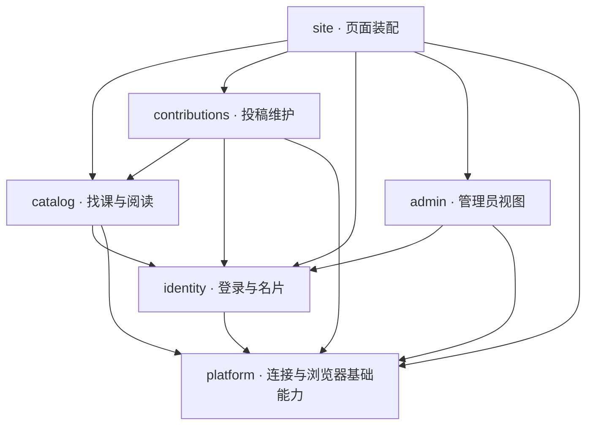

# RateMyCourse · Architecture

更新：2026-11-26（日本时间）。**先通过本页定位 module，再按任务深入 implementation。** 产品行为见 [PRD.md](PRD.md)，视觉与交互见 [DESIGN.md](DESIGN.md)。

源码按六个业务 module 组织，起点为 `77a2aea`。实际发布版本以正式站 `release-manifest.json` 中的 revision / mode 为准；本页描述当前源码及其打包发布方式。

## 1. 第一层：六个 module

```text
repo/
├── PRD.md / ARCH.md / DESIGN.md
├── AGENTS.md                 Agent 阅读与文档维护约定
├── index.html                网站入口
├── community.html            历史链接兼容入口
├── courses-shell.html        可直接访问的课程页面壳
├── guide.html                免费指南入口
├── analytics.html            管理员入口
├── .github/workflows/pages.yml  GitHub Pages 发布
├── .nojekyll
├── src/
│   ├── site/                 页面装配、蓝调海湾首页、指南、导航与 Pages 打包校验
│   ├── catalog/              找课、筛选、课程及评价阅读
│   ├── contributions/        投稿、草稿、预览及稿件维护
│   ├── identity/             登录、资料、照片及公开身份
│   ├── admin/                管理员统计与资料视图
│   └── platform/             连接、统计传输与浏览器基础能力
└── assets/                   仍由工作区名片墙使用的三张历史人物图
```

首层是业务职责，不是函数目录。一个 module 的 interface 应比内部 implementation 简单；内部可以有多个文件，调用者不应理解其状态排列和查询细节。



依赖既有显式 import，也有 site 注入的协作对象。图只画 module，不展开内部 helper。其他 module 不反向 import site；catalog 不调用 contributions；identity 不读取 catalog 内部状态；platform 不依赖业务 module。

## 2. 每个 block 隐藏什么

跨 module 通过各自 `index.js` 协作；内部文件用于定位和维护，不是其他 module 的额外入口。

| Module / 入口 | 隐藏的 implementation | 主要 interface |
| --- | --- | --- |
| [site](src/site/index.js) | 默认首页／课程模式路由、页面壳、语言、页面级事件装配；`landing/` 内含正式装配 [landing/index.js](src/site/landing/index.js)、单一职责海湾首屏 [bay-hero.js](src/site/landing/bay-hero.js)、真实精选摘录 [previews.js](src/site/landing/previews.js) 与 Shadow DOM 环形名片轮播 `student-carousel/`；[build-pages.mjs](src/site/build-pages.mjs) 负责装包与发布前断言 | HTML 入口启动；[workspace.js](src/site/workspace.js) 只装配业务 module，不包含业务表查询或投稿保存分支；[landing/index.js](src/site/landing/index.js) 只通过 `identity` 的 `getAuth` 与 `getContributorWall` 协作。 |
| [catalog](src/catalog/index.js) | 列表／详情、公开字段投影、alias、缓存寿命与失效、筛选、原文与译文阅读 | `createCatalog` 为页面提供读取、渲染及交互；`createCatalogStore` 是可独立验证的读取 seam；目录规则亦从入口导出。 |
| [contributions](src/contributions/index.js) | 新稿／改稿、原文 payload、学期、草稿、公开预览、确认、本人列表和人工复核 | `createContributions` 管理页面流程；`createContributionFlow` 隐藏作者与 revision、保存去重和持久化命令；`reviewPayload` 保留纯规则。 |
| [identity](src/identity/index.js) | 会话、返回目标、资料资格、Profile、照片草稿／上传、签名图片缓存、公开名片及墙数据 | `getAuth`、`createIdentity`、`getContributorWall`、`profilePolicy`；作者筛选意图交回 site，不反向调用课程内部实现。 |
| [admin](src/admin/index.js) | 管理员资格入口、统计及私有资料目录 | `createAdminAccess` 给导航提供资格状态，`mountAdmin` 管理受权限限制的视图。最终权限由后端执行。 |
| [platform](src/platform/index.js) | Supabase SDK 加载和唯一 client、公开配置、统计传输、表单忙碌反馈及分属各业务的草稿存储机制 | `getPlatform`、`getMetrics` 及浏览器基础能力；业务查询投影和规则继续留在所属 module。 |

`view` 是 site 提供的窄协作对象：语言、消息、DOM 展示工具、当前页面代次及导航／重绘回调。它不承载课程数组、作者资料、编辑版本或草稿状态；这些状态分别由所属 module 管理。

## 3. depth 与 locality 的实际变化

- **正式首页装配**：[landing/index.js](src/site/landing/index.js) 集中管理真实登录路由（`getAuth`）、实时上墙权限校验（`getContributorWall`，fail-closed）、语言切换与事件生命周期；[bay-hero.js](src/site/landing/bay-hero.js) 封装蓝调海湾的渲染、等比枝叶取景、异步 GSAP/ScrollTrigger 加载与清理，不含已淘汰方案的条件分支；`student-carousel/` 封装 3D 圆柱渲染与翻面交互，只接收宿主过滤后的已授权 `allowedIds` 与 `onSelectPerson` 回调。
- **课程读取**：[store.js](src/catalog/store.js) 集中查询字段、alias、60 秒缓存、并发读取合并、失败恢复及失效；site 不再知道字段字符串或 TTL。
- **投稿流程**：[flow.js](src/contributions/flow.js) 集中预览状态、作者、目标稿件、expected revision、保存分支和在途请求；site 不再操作确认标记或调用编辑 RPC。
- **异步保存**：旧页面请求不能激活新表单上下文；同一在途确认只发一次写入；成功确认不能重放；服务器已成功写入不会仅因页面变化被标为失败。
- **学期验证**：确认时绑定所选学期的验证上下文，保存中即使旧控件被销毁也不读取新页面的 DOM；官方开始日期与旧值保留规则不变。
- **身份与照片**：资料、照片编辑、公开选择、签名 URL 与名片墙归 identity；Landing 与工作区通过同一公开墙 adapter 读取，失败时不恢复已撤下的人物。
- **草稿**：[drafts.js](src/platform/drafts.js) 只处理表单记录机制；identity 和 contributions 分别持有实例。账号／目标键、同标签页存储键保持原格式。

这是 deletion test 的落点：页面删去了演示状态与冗余多候选分支，正式业务规则集中在所属 module，公开装包校验集中在发布模块。

## 4. 启动与数据流

```text
index.html → src/site/index.js
               ├─ 无 #/：Landing CSS → site/landing/index.js
               │            ├─ bay-hero.js（异步按需加载 vendor/gsap + ScrollTrigger）
               │            ├─ getContributorWall() → 有公开名片时按需加载 student-carousel/index.js
               │            └─ getAuth() → 真实 Google OAuth 弹窗与回跳
               └─ 有 #/：courses-shell.html → site/workspace.js
community.html → site/community-redirect.js → 根 URL，保留 query/hash
courses-shell.html → site/workspace.js（直接访问仍可用）
guide.html → site/guide.js → catalog 的学部目录 + platform 统计
analytics.html → site/admin-entry.js → identity + admin
```

页面主体使用浏览器原生 ES modules，无整站打包器或自建 Web 服务器；仅 `student-carousel/index.js` 为独立的预构建 Shadow DOM ESM 组件（源码保留在 `student-carousel/src/`，打包时自动排除出公开产物）。Pages Actions 只组装静态发布包并运行内建发布断言。相对 URL 保留 GitHub Pages 项目子路径。专用字体、海湾素材、GSAP 及许可证留在 `src/site/landing/`，工作区共享人物图片保留根 `assets/` URL。

- 浏览器 → Supabase Auth / PostgreSQL / Storage；公开配置仅包含浏览器可用的 publishable key。
- 公开课程／评价读取归 catalog；本人稿件读写和复核归 contributions；身份／照片归 identity；管理员读取归 admin。
- RLS、所有权、版本冲突、审核版本及发布仍由数据库执行。前端 interface 不复制最终批准规则。
- profile 页面不再先等完整课程目录；需要课程上下文的列表、详情、投稿及本人列表才加载目录。
- `getAuth` 对初始就绪、OAuth 返回与后续事件沿用既有行为。

## 5. 历史归档与完整系统

已迁出当前活跃仓库：
- `Archive/Website-Legacy-2026-11-01/`：三套旧 `design-demos` 及截图、旧 `app/data/locale/styles`、废弃 `auth-shell`、旧船只／原则插图及历史批准记录（27 条清单）。
- `Archive/Landing-WarmPaper-2026-11-26/`：被蓝调海湾正式首页取代的暖纸首页代码与专属素材（7 条清单，含 SHA-256 与提交 `8a06065` 恢复步骤）。归档没有改写 Git 历史，也不影响历史缓存发布包。

历史批准记录的公开可追溯版本：[direction-approved.md @ 77a2aea](https://github.com/huangyuanchang2006/ratemycourse/blob/77a2aea999b5c6be98601368097d7658d4bc3f9f/direction-approved.md)。当前有效规则已写入 PRD 与 DESIGN；归档不等于重新批准旧页面。

数据库迁移、审核 worker、完整 QA 与原始研究仍在本地专用目录，**不随网站仓库公开**。只 clone repo 可以查看前端及三份核心文档，不能重建完整后端或重复本机全部验收。

`Reference/`、`QA/`、`Archive/`、`Private/`、凭据和私有会话不能进入发布包。发布平台继续仅 GitHub Pages，正式分支 `main`；不改远端名称，不使用其他部署平台。

## 6. 验证与变更纪律

### 跨版本缓存、打包校验与回退

旧缓存曾触发 module 被 classic loader 执行的问题。现已通过 [workspace-entry.js](src/site/workspace-entry.js) 的双模式动态 import 桥接，以及固定版本发布包解决。

- [build-pages.mjs](src/site/build-pages.mjs) 只复制明确白名单并显式排除构建工具与 JSX 源码（`build-pages.mjs`、`pages-compatibility.json`、`student-carousel/src/`、`student-carousel/README.md`）；不读凭据、不联网、不连数据库。
- 组装完成后，`build-pages.mjs` 内的 `verifyRelease()` 会强制校验：
  1. 产物不含 `.jsx`、演示／候选脚本（`homepage.*`、`tokyo-hero.*`）、构建脚本或私有目录；
  2. 当前 release 必需的 Landing、Hero、Carousel、素材与 Workspace 入口全部存在；
  3. `previousModuleReleases` 中列出的所有历史线上版本图（`fbdc3f1`、`db8d9ac`、`fe7a1ea`、`9af85c0`、`8e48dfb`）均已完整打包；
  4. 非回退模式下，根 `index.html` 指向不可变的 `releases/<revision>/src/site/index.js`。
- `.github/workflows/pages.yml` 使用固定 SHA 的官方 Pages Actions，只允许 `main`，发布同一 Pages 站点。classic 基线固定为 `77a2aea`。
- **下一次发布前**：将目前线上 module revision 加入 [pages-compatibility.json](src/site/pages-compatibility.json) 的 `previousModuleReleases`，不能未经兼容验证删除旧入口资源或版本目录。
- 紧急回退：在 `main` 手动运行 Publish Pages，令 `rollback=true`。它恢复固定基线的根页面，仍保留当前及清单中的 module 图，避免已缓存新版入口失效。恢复新版时用 `rollback=false` 重跑。

官方发布机制：[GitHub Pages 自定义工作流说明](https://docs.github.com/en/pages/getting-started-with-github-pages/using-custom-workflows-with-github-pages)。

后续每次变更：

1. 从下表定位 module，先读 PRD 对应行为；涉及呈现再读 DESIGN。
2. 修改所属 implementation，不越过 seam 使用另一个 module 的内部状态或文件。
3. 运行与变更有关的 interface、打包校验和浏览器检查；涉及数据库合同再验证后端约束。
4. 在同一变更中更新相关核心文档，并按明确文件清单暂存。推送／部署仍是单独的发布动作。

| 改动 | 首先深入 |
| --- | --- |
| 筛选、课程读取、alias、缓存 | `catalog/index` → `rules` / `store` |
| 课程详情、原文、译文或公开预览呈现 | `catalog/index` → `translations`；同时核对 DESIGN |
| 投稿、学期、版本、失败恢复、复核 | `contributions/index` → `flow` / `rules` / `term-picker` / `feedback` |
| 登录返回、Profile、照片、公开身份 | `identity/index` → `auth` / `policy` / `photos` / `wall` |
| 首页、导航、指南、路由装配、Pages 装包 | `site/index` → `landing`（`index` / `bay-hero` / `previews` / `student-carousel`）/ `workspace` / `guide` / `build-pages` |
| 管理员目录或统计报表 | `admin/index` |
| SDK 连接、统计传输、共用表单机制 | `platform/index` → 对应内部 implementation |

## 7. 三份文档的更新合同

| 文档 | 何时更新 | 不放什么 |
| --- | --- | --- |
| PRD | 产品对象、功能状态、行为与访问规则变化 | 文件搬迁日志、未批准功能承诺 |
| ARCH | module、interface、依赖、入口、存储或运行方式变化 | 视觉探索画廊、私密运维记录 |
| DESIGN | 视觉、交互、可访问性、资产及内容呈现约定变化 | 作者正文副本、权限规则的重复定义 |

事实只维护一处，其余链接引用。无需三份每次一起改，不为每个 helper 追加说明文档。当前实现、已确认未实现和实验必须明确区分。
