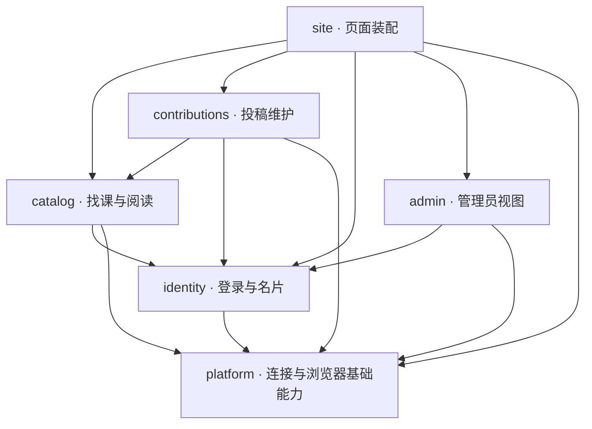

# RateMyCourse · Architecture

更新：2026-11-01（日本时间）。**先通过本页定位 module，再按任务深入 implementation。** 产品行为见 [PRD.md](PRD.md)，视觉与交互见 [DESIGN.md](DESIGN.md)。

六个 module 已完成重组，起点为 `77a2aea`。实际发布版本以正式站 `release-manifest.json` 中的 revision / mode 为准；本页描述源码及其发布方式。

## 1. 第一层：六个 module

```text
repo/
├── PRD.md / ARCH.md / DESIGN.md
├── AGENTS.md                 Agent 阅读与文档维护约定
├── index.html                网站入口
├── community.html            历史链接兼容入口
├── courses-shell.html        可直接访问的课程页面壳
├── guide.html                免费指南入口
├── analytics.html            管理员入口
├── .github/workflows/pages.yml  GitHub Pages 发布
├── .nojekyll
├── src/
│   ├── site/                 页面装配、首页、指南与导航
│   ├── catalog/              找课、筛选、课程及评价阅读
│   ├── contributions/        投稿、草稿、预览及稿件维护
│   ├── identity/             登录、资料、照片及公开身份
│   ├── admin/                管理员统计与资料视图
│   └── platform/             连接、统计传输与浏览器基础能力
└── assets/                   仍由名片墙使用的三张历史人物图
```

首层是业务职责，不是函数目录。一个 module 的 interface 应比内部 implementation 简单；内部可以有多个文件，调用者不应理解其状态排列和查询细节。



依赖既有显式 import，也有 site 注入的协作对象。图只画 module，不展开内部 helper。其他 module 不反向 import site；catalog 不调用 contributions；identity 不读取 catalog 内部状态；platform 不依赖业务 module。

## 2. 每个 block 隐藏什么

跨 module 通过各自 `index.js` 协作；内部文件用于定位和维护，不是其他 module 的额外入口。

| Module / 入口 | 隐藏的 implementation | 主要 interface |
| --- | --- | --- |
| [site](src/site/index.js) | 默认首页／课程模式、页面壳、路由、语言、页面级事件装配；Landing 自己的视觉与动效 | HTML 入口启动；[workspace.js](src/site/workspace.js) 只装配业务 module，不包含业务表查询或投稿保存分支。 |
| [catalog](src/catalog/index.js) | 列表／详情、公开字段投影、alias、缓存寿命与失效、筛选、原文与译文阅读 | `createCatalog` 为页面提供读取、渲染及交互；`createCatalogStore` 是可独立验证的读取 seam；目录规则亦从入口导出。 |
| [contributions](src/contributions/index.js) | 新稿／改稿、原文 payload、学期、草稿、公开预览、确认、本人列表和人工复核 | `createContributions` 管理页面流程；`createContributionFlow` 隐藏作者与 revision、保存去重和持久化命令；`reviewPayload` 保留纯规则。 |
| [identity](src/identity/index.js) | 会话、返回目标、资料资格、Profile、照片草稿／上传、签名图片缓存、公开名片及墙数据 | `getAuth`、`createIdentity`、`getContributorWall`、`profilePolicy`；作者筛选意图交回 site，不反向调用课程内部实现。 |
| [admin](src/admin/index.js) | 管理员资格入口、统计及私有资料目录 | `createAdminAccess` 给导航提供资格状态，`mountAdmin` 管理受权限限制的视图。最终权限由后端执行。 |
| [platform](src/platform/index.js) | Supabase SDK 加载和唯一 client、公开配置、统计传输、表单忙碌反馈及分属各业务的草稿存储机制 | `getPlatform`、`getMetrics` 及浏览器基础能力；业务查询投影和规则继续留在所属 module。 |

`view` 是 site 提供的窄协作对象：语言、消息、DOM 展示工具、当前页面代次及导航／重绘回调。它不承载课程数组、作者资料、编辑版本或草稿状态；这些状态分别由所属 module 管理。

## 3. depth 与 locality 的实际变化

- **课程读取**：[store.js](src/catalog/store.js) 集中查询字段、alias、60 秒缓存、并发读取合并、失败恢复及失效；site 不再知道字段字符串或 TTL。
- **投稿流程**：[flow.js](src/contributions/flow.js) 集中预览状态、作者、目标稿件、expected revision、保存分支和在途请求；site 不再操作确认标记或调用编辑 RPC。
- **异步保存**：旧页面请求不能激活新表单上下文；同一在途确认只发一次写入；成功确认不能重放；服务器已成功写入不会仅因页面变化被标为失败。
- **学期验证**：确认时绑定所选学期的验证上下文，保存中即使旧控件被销毁也不读取新页面的 DOM；官方开始日期与旧值保留规则不变。
- **身份与照片**：资料、照片编辑、公开选择、签名 URL 与名片墙归 identity；Landing 与工作区通过同一公开墙 adapter 读取，失败时不恢复已撤下的人物。
- **草稿**：[drafts.js](src/platform/drafts.js) 只处理表单记录机制；identity 和 contributions 分别持有实例。账号／目标键、同标签页存储键保持原格式。

这是 deletion test 的落点：页面删去了上述业务协调知识。只把原函数移入文件夹，或新增逐条转发的 shallow module，都不足以完成重构。

测试 adapter 与生产 Supabase adapter 通过真实 interface 验证相同行为；不为假想替换再制造 seam。未来新增职责应优先增加 module 的 depth 和 locality，以一处规则提供多个调用路径的 leverage。

## 4. 启动与数据流

```text
index.html → src/site/index.js
               ├─ 无 #/：Landing CSS/vendor → site/landing/index.js
               └─ 有 #/：courses-shell.html → site/workspace.js
community.html → site/community-redirect.js → 根 URL，保留 query/hash
courses-shell.html → site/workspace.js（直接访问仍可用）
guide.html → site/guide.js → catalog 的学部目录 + platform 统计
analytics.html → site/admin-entry.js → identity + admin
```

页面使用浏览器原生 ES modules，无框架、JS 打包器或自建 Web 服务器；Pages Actions 只组装静态发布包。相对 URL 保留 GitHub Pages 项目子路径。专用字体、图片与 GSAP 及许可证留在 `src/site/landing/`，共享人物图片保留原 `assets/` URL。

- 浏览器 → Supabase Auth / PostgreSQL / Storage；公开配置仅包含浏览器可用的 publishable key。
- 公开课程／评价读取归 catalog；本人稿件读写和复核归 contributions；身份／照片归 identity；管理员读取归 admin。
- RLS、所有权、版本冲突、审核版本及发布仍由数据库执行。前端 interface 不复制最终批准规则。
- profile 页面不再先等完整课程目录；需要课程上下文的列表、详情、投稿及本人列表才加载目录。
- `getAuth` 对初始就绪、OAuth 返回与后续事件沿用既有行为。更全面的认证状态模型没有在本次重组中重写。

## 5. 历史归档与完整系统

已迁出当前活跃仓库：三套 `design-demos` 及截图、旧 app/data/locale/styles、废弃 auth-shell、旧船只／原则插图，以及历史批准记录。归档没有改写 Git 历史。

本地项目的 `Archive/Website-Legacy-2026-11-01/` 保留原相对结构、HTML、截图和依赖；`manifest.json` 记录来源提交、SHA256、原路径、处理理由及恢复步骤。共 27 条记录，其中三张人物图是归档依赖副本，活跃副本仍在网站；其余 24 项退出活跃目录。

历史批准记录的公开可追溯版本：[direction-approved.md @ 77a2aea](https://github.com/huangyuanchang2006/ratemycourse/blob/77a2aea999b5c6be98601368097d7658d4bc3f9f/direction-approved.md)。当前有效规则已写入 PRD 与 DESIGN；归档不等于重新批准旧页面。需要重新尝试某个视觉方向时，从归档取候选，明确实验状态，再只合并选定规则及资产。

数据库迁移、审核 worker、完整 QA 与原始研究仍在本地专用目录，**不随网站仓库公开**。只 clone repo 可以查看前端及三份核心文档，不能重建完整后端或重复本机全部验收。审核 worker 的当前在线状态未在本轮核查。

`Reference/`、`QA/`、`Archive/`、`Private/`、凭据和私有会话不能进入发布包。发布平台继续仅 GitHub Pages，正式分支 main；不改远端名称，不使用其他部署平台。

## 6. 验证与变更纪律

### 跨版本缓存与回退

旧缓存曾触发 module 被 classic loader 执行的问题。现已通过 [workspace-entry.js](src/site/workspace-entry.js) 的双模式动态 import 桥接，以及固定版本发布包解决。

- [build-pages.mjs](src/site/build-pages.mjs) 只复制明确白名单；不读凭据、不联网、不连数据库。发布包不含研究／QA／归档、旧 demo／app／data 或构建工具。
- 根 HTML 指向 `releases/<commit>/src/`，整张相对 import 图处在同一不可变版本下。发布包另外保留 [兼容清单](src/site/pages-compatibility.json) 指定的上一版 classic 运行资源；源码根目录不恢复这些旧脚本。
- `.github/workflows/pages.yml` 使用固定 SHA 的官方 Pages Actions，只允许 main，发布同一 Pages 站点。首次 module 发布的 classic 基线固定为 `77a2aea`。
- **下一次发布前**：将目前线上 module revision 加入 `previousModuleReleases`，保留已缓存 HTML 指向的旧图；不能未经兼容验证删除旧入口资源或版本目录。
- 紧急回退：在 main 手动运行 Publish Pages，令 rollback=true。它恢复固定基线的根页面，仍保留当前及清单中的 module 图，避免已缓存新版入口失效。恢复新版时用 rollback=false 重跑。不要直接删除工作流或切回旧 commit 后假设会自动发布。
- 本地已验证 12 项新旧缓存与回退组合，以及业务回归；真实 Pages 发布后仍须核对 manifest、文件哈希和只读入口。

官方发布机制：[GitHub Pages 自定义工作流说明](https://docs.github.com/en/pages/getting-started-with-github-pages/using-custom-workflows-with-github-pages)。它只改变同一 Pages 的发布方式，平台仍为 GitHub Pages，正式分支仍为 main。本次无 SQL 迁移，不为验证写入生产数据。

本轮本地验证记录位于项目专用 QA 目录，覆盖 module interface、迁移前后的中英／桌面／手机页面对照、投稿与原文、账号／草稿／并发保存、入口资源和隔离数据库合同。最终结果与范围保存在该目录 README；这些检查不代表已部署或真实 OAuth 已完成。

旧 source-injection 检查保留为历史证据，不修改原文件以迎合新结构。活跃检查直接 import module interface，并使用本地浏览器中的模拟认证／数据库 transport；已废弃 auth-shell 的旧界面检查由当前 Landing／工作区登录检查替代。测试夹具不进入生产页面。

后续每次变更：

1. 从下表定位 module，先读 PRD 对应行为；涉及呈现再读 DESIGN。
2. 修改所属 implementation，不越过 seam 使用另一个 module 的内部状态或文件。
3. 运行与变更有关的 interface 和浏览器检查；涉及数据库合同再验证后端约束。
4. 在同一变更中更新相关核心文档，并按明确文件清单暂存。推送／部署仍是单独的发布动作。

| 改动 | 首先深入 |
| --- | --- |
| 筛选、课程读取、alias、缓存 | catalog/index → rules / store |
| 课程详情、原文、译文或公开预览呈现 | catalog/index → translations；同时核对 DESIGN |
| 投稿、学期、版本、失败恢复、复核 | contributions/index → flow / rules / term-picker / feedback |
| 登录返回、Profile、照片、公开身份 | identity/index → auth / policy / photos / wall |
| 首页、导航、指南、路由装配 | site/index → landing / workspace / guide / navigation |
| 管理员目录或统计报表 | admin/index |
| SDK 连接、统计传输、共用表单机制 | platform/index → 对应内部 implementation |

## 7. 三份文档的更新合同

| 文档 | 何时更新 | 不放什么 |
| --- | --- | --- |
| PRD | 产品对象、功能状态、行为与访问规则变化 | 文件搬迁日志、未批准功能承诺 |
| ARCH | module、interface、依赖、入口、存储或运行方式变化 | 视觉探索画廊、私密运维记录 |
| DESIGN | 视觉、交互、可访问性、资产及内容呈现约定变化 | 作者正文副本、权限规则的重复定义 |

事实只维护一处，其余链接引用。无需三份每次一起改，不为每个 helper 追加说明文档。当前实现、已确认未实现和实验必须明确区分。
